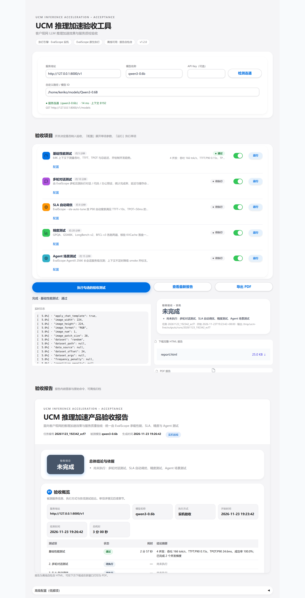

# UCM 推理加速验收工具

面向客户现网环境的 LLM 推理加速验收工具。对 OpenAI 兼容推理服务（vLLM / SGLang / TGI 等）执行性能、多轮对话、SLA、精度、Agent 五项验收测试，生成自包含 HTML 验收报告。测试由 [EvalScope](https://github.com/modelscope/evalscope) 原生执行，工具负责参数编排、执行与结果呈现。

支持离线部署：工具、依赖、tokenizer 与数据集可全部预置于安装包内。



> 界面实时预览：main 分支每次更新后，CI 自动截图发布到 GitHub Pages ——
> **https://ucm-system.github.io/ucm-accept/**

---

## 1. 安装

### 1.1 Windows

1. 解压 `ucm-accept-windows-x64.zip` 至任意目录（需保留 `_internal` 目录与 exe 同级）；
2. 打开命令提示符，进入解压目录：

```bat
cd /d D:\ucm-accept
ucm-accept.exe --gui
```

浏览器将自动打开工具页面。

### 1.2 Linux

```bash
# deb 包（麒麟 V10 / Ubuntu / Debian）
sudo dpkg -i ucm-accept_1.2.0_amd64.deb

# rpm 包（openEuler / 麒麟）
sudo rpm -ivh ucm-accept-1.2.0-1.x86_64.rpm

# portable tar 包（无需管理员权限）
tar -xzf ucm-accept-linux-amd64.tar.gz
./ucm-accept-linux-amd64/ucm-accept --gui
```

deb/rpm 安装后会在桌面创建「UCM 验收工具」入口，亦可直接执行 `ucm-accept --gui`。

### 1.3 容器

```bash
docker load -i ucm-accept-1.2.0-amd64.tar
docker run --rm -it -p 8080:8080 \
  -v /data/ucm:/data \
  ucm-accept:1.2.0 --gui --host 0.0.0.0 --port 8080
```

在浏览器访问 `http://<服务器IP>:8080`。去除 `--gui` 相关参数则进入 CLI 菜单模式。

### 1.4 离线工具包（含全部依赖）

`ucm-accept-offline-tooling-<版本>-<架构>.tar.gz` 内含验收工具、全部依赖 wheel、离线配置模板与本文档：

```bash
tar -xzf ucm-accept-offline-tooling-1.2.0-amd64.tar.gz -C offline && cd offline
python -m venv .venv && source .venv/bin/activate
pip install --no-index --find-links wheelhouse "ucm-accept==1.2.0" "evalscope[perf,service]>=1.15,<2"
ucm-accept --doctor --probe
```

安装要求：Python 3.10+（Agent 场景需 3.11–3.13）。

---

## 2. 配置

### 2.1 必填项（GUI「验收执行」页顶部）

| 参数 | 说明 |
|---|---|
| 服务地址 | 被测推理服务地址，格式 `http://<IP>:<端口>/v1` |
| 模型名称 | 被测模型名称，可通过「检测连通」获取服务实际提供的名称 |
| API Key | 可选，服务启用鉴权时填写 |

填写后点击「检测连通」，状态为绿色即配置生效。

### 2.2 可选项（GUI「测试配置」面板 / `config.yaml`）

全部参数均有默认值，默认口径为：基础性能 并发 8 / 请求 64 / 输入 65536 / 输出 512 / 命中率 90% / 前缀种数 32；SLA 输入 65536 / 输出 512 / 命中率 90% / 前缀种数 8 / 搜索上限 256，阈值 avg_ttft ≤ 30s、avg_tpot ≤ 50ms（avg / P99 档位均可配置）；精度默认两轮（先全量一轮再全量第二轮）。可修改项包括：性能多组口径、并发梯度、SLA 阈值档位、精度数据集启停、报告标题与署名等。

修改后的配置可点击「保存到配置文件」持久化，后续启动通过 `--config <路径>` 复用；亦可通过「导出 / 导入」在环境间迁移。API Key 不写入配置文件。

配置文件完整说明见 [`ucm_accept/resources/config.yaml`](ucm_accept/resources/config.yaml) 内注释，支持 `${ENV_VAR:-默认值}` 形式的环境变量展开。

### 2.3 测试范围

默认执行全部五项测试。可在以下位置调整：

- GUI：顶部「验收范围」勾选框；
- CLI：`--items perf,sla`（支持名称或编号，如 `--items 1,3`）；
- 配置文件：`run.items` 字段。

报告结论按实际执行范围计算，并在报告中标注。

---

## 3. 执行验收测试

### 3.1 前置检查

```bash
ucm-accept --doctor --probe
```

自检覆盖 Python 版本、配置合法性、EvalScope 版本（≥1.15）、资产包完整性（SHA256）、tokenizer、数据集缓存、服务连通性。全部通过后方可执行验收。

### 3.2 执行

**GUI**：点击测试卡片上的「运行」执行单项，或点击「执行所选测试项」按勾选范围顺序执行。

**CLI**：

```bash
ucm-accept --all --base-url http://<IP>:<端口>/v1 --model <模型名>
```

执行过程中输出实时进度与 EvalScope 日志摘要。默认参数下五项合计约 1 小时；各项预计耗时见第 6 节。

### 3.3 中断与容错

| 场景 | 行为 |
|---|---|
| 浏览器页面被关闭 | 测试在后台继续执行，结果正常落盘；重新打开页面后工具自动加载最近一次报告（或点击「查看最新报告」） |
| 应用进程被关闭（`Ctrl+C` / 关闭终端 / `kill`） | 当前测试项被终止（EvalScope 子进程一并终止），该项标记为「已取消」，报告与已完成项的原始数据立即落盘到 `<报告目录>/runs/<任务号>/` |
| 单项失败 / 中断后再执行 | 重新执行同一项会覆盖该项结果并重算结论；其余项结果保留 |

报告目录中每次执行独立成 `<任务号>` 目录，包含 `report.html`、`report.json` 与各项原始数据，可直接归档。

---

## 4. 获取结果

| 位置 | 说明 |
|---|---|
| GUI「验收报告」区域 | 实时预览，点击「下载完整 HTML 报告」保存 |
| CLI 输出 | 命令结束时打印报告路径 |
| 输出目录 | `<报告目录>/runs/<任务号>/`，含 `report.html`、`report.json` 与各项原始数据 |

报告为自包含单文件 HTML（图表、命令、原始数据索引全部内嵌），可直接分发。PDF 通过浏览器打开报告后打印生成。

验收结论分为四种：**通过**（全部达标）、**有条件通过**（存在需关注项，报告中说明）、**不通过**（存在未达标项，报告含差距说明）、**未完成**（执行中断）。

---

## 5. 状态与错误处理

### 5.1 连通检测失败

| 现象 | 处理 |
|---|---|
| 无法连接服务 | 确认服务地址与端口；在服务所在机器执行 `curl http://<地址>/models` 验证 |
| 地址格式错误 | 服务地址须以 `/v1` 结尾 |
| 模型名称不匹配 | 访问 `http://<地址>/v1/models` 获取实际模型名称 |

### 5.2 自检异常

| 检查项 | 处理 |
|---|---|
| EvalScope 未找到 / 版本 < 1.15 | 安装或升级 `evalscope[perf]>=1.15`；旧版本可临时将 `sla.mode` 设为 `verify` |
| Tokenizer 不存在 | 将离线资产包置于工具同级 `assets/` 目录，或通过 `UCM_ASSETS_DIR` 指定路径 |
| 数据集缓存缺失 | 在联网环境预热（见第 6 节），或暂不执行精度项 |
| 报告目录不可写 | 通过 `--outputs` 或配置 `app.report_dir` 更换目录，并确认属主权限 |

### 5.3 验收结论为不通过

报告中包含未达标项的实测值与阈值差距、各项原始输出目录及可复现命令。性能未达标转调优处理；精度不稳定核对两遍得分明细。

---

## 6. 离线环境

工具与全部依赖支持离线部署，需两个交付物：

1. **工具安装包**（第 1 节任一形态）；
2. **离线资产包 `ucm-assets/`**：tokenizer、多轮预设、精度数据集缓存、SHA256 清单。

接入方式：Docker 通过 `-v <资产包>:/opt/ucm-accept/assets:ro` 挂载；deb/rpm 安装至 `/opt/ucm-accept/assets`；Windows/portable 将资产包目录命名为 `assets/` 放置于可执行文件同级；其余场景设置环境变量 `UCM_ASSETS_DIR=<路径>` 或配置 `app.assets_dir`。工具按固定顺序自动发现并逐文件校验 SHA256。

精度数据集的离线预热与资产包组装流程（含 ModelScope snapshot 下载、arrow 缓存移植、环境变量清单）见 **[docs/offline-build.md](docs/offline-build.md)**。

---

## 7. 验收项说明

| 验收项 | 内容 | 默认口径 | 预计耗时 |
|---|---|---|---|
| 基础性能 | 多组口径下的吞吐、TTFT、TPOT、总延迟及并发趋势 | 默认 并发 8 / 请求 64 / 输入 65536 / 输出 512 / 命中率 90%（可配多组） | ~5 分钟 |
| 多轮对话 | 多轮会话完成率、延迟、KV Cache 命中率 | 对话/代码/办公预设，12 组 × 2–5 轮 | ~10 分钟 |
| SLA 自动调优 | avg / P99 时延是否满足阈值（EvalScope `--sla-auto-tune` 原生判定） | 上限 256 并发、avg_ttft≤30s、avg_tpot≤50ms | ~8 分钟 |
| 精度测试 | 数学/问答/长文本/工具调用得分与两遍一致性 | GPQA、GSM8K、LongBench-v2、BFCL-v3 各 2 遍 | ~20 分钟 |
| Agent 场景 | 256K 长会话服务级压测（AgentX） | 持续 15 分钟负载 | ~15 分钟 |

---

## 附录

- **架构原则**：全部测试由 EvalScope 原生命令执行（`perf` / `eval` / `--sla-auto-tune` / `--scenario agentx`），本工具不实现压测或评分算法；所有数值可追溯至 EvalScope 原始输出与 `command.txt` 记录的可复现命令。
- **模拟模式**：`ucm-accept --mock --fast --all` 在不接模型服务的情况下完整执行流程，用于交付演示与 CI 虚跑；报告标注「模拟数据，不作为验收结论」。
- **配置参考**：[`ucm_accept/resources/config.yaml`](ucm_accept/resources/config.yaml)；可用 `evalscope.<x>_command` 整体覆写 argv 以适配客户侧 EvalScope 版本差异。
- **资产包构建**：[docs/offline-build.md](docs/offline-build.md)（统一资产包一次构建，Docker / deb / rpm / exe / wheel 四形态共用）。
- **打包流水线**：[docs/packaging-pipeline.md](docs/packaging-pipeline.md)。产物：wheel/sdist、Windows exe、Linux deb/rpm/portable tar、amd64/arm64 Docker 镜像、离线 wheelhouse、SHA256SUMS。
- **开发**：`pip install -e ".[dev,gui]"`；`ruff check ucm_accept tests scripts && pytest -q`。
- **版本**：[CHANGELOG.md](CHANGELOG.md)，当前 1.2.0。
